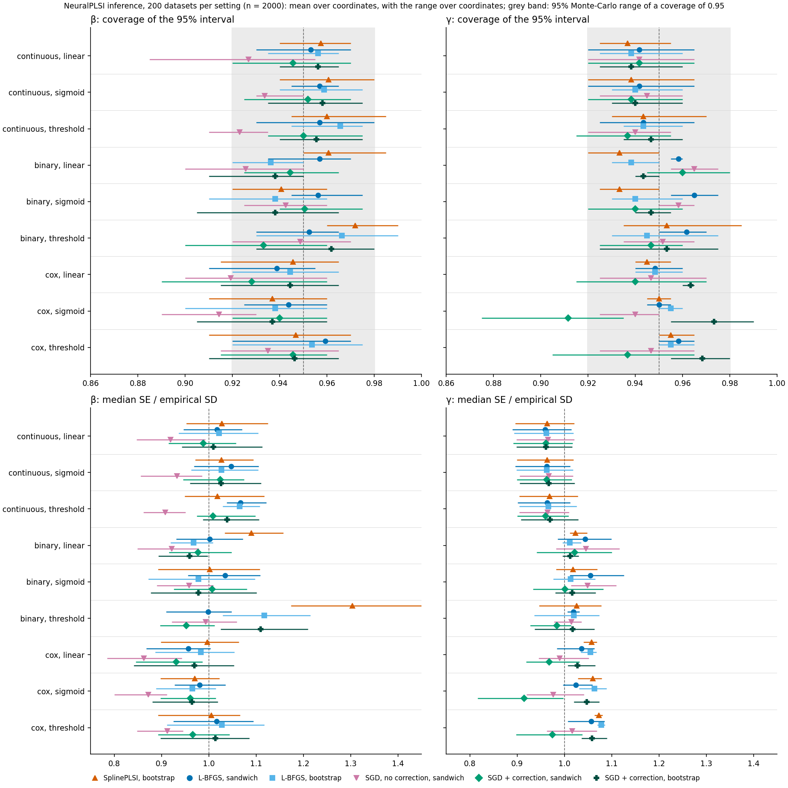

# Sandwich standard errors for NeuralPLSI and SplinePLSI

Standard errors for β and γ from the curvature of the fitted objective, with no
refitting, tested against the truth in simulation, for the two ways NeuralPLSI
is fitted.

## What is proposed

| | Fit | Inference |
|---|---|---|
| (1) | L-BFGS (`optimizer='lbfgs'`, the default) | full sandwich |
| (1-2) | the same | pairs bootstrap |
| (2) | minibatch AdamW + frozen correction (`optimizer='adam_frozen'`) | frozen sandwich |
| (2-2) | the same | pairs bootstrap |
| comparator | minibatch AdamW + exact γ fit (`optimizer='adam_exact_gamma'`) | (shows that correcting γ alone is not enough) |

(1) is for networks and data that full-batch L-BFGS can fit; (2) scales to
networks and data that it cannot. The bootstrap columns come from the main
simulation (`results/simulation`, to be rerun with these methods); this
directory has the sandwiches, for continuous, binary and Cox outcomes. For Cox
outcomes the partial likelihood is not a sum of independent row terms, and the
rows' scores are Lin and Wei's score residuals of the Breslow partial likelihood.
`inference_methods.png` shows every method side by side, with the bootstraps of
the main simulation.

## Method

NeuralPLSI's fit minimizes the penalized objective

    Q(θ) = (1/n) Σ_i l_i(θ) + g(0)² + (λ/2) |network|²

over β, γ, the skip weight, every weight and bias of the network and the
intercept (1164 parameters for 8 exposures, 3 confounders and a 2 × 32
network). At a minimum of Q, the M-estimator sandwich is

    Var(θ̂) ≈ H⁻¹ C H⁻¹ / n,   H = ∇²Q(θ̂),   C = Cov(∇l_i(θ̂)).

β is identified only up to scale, so it enters as coordinates d in the tangent
plane of the unit sphere (β = b + T d, T an orthonormal basis of the complement
of b, b the fitted raw β weights), and the unit-length β moves by T d / |b|.

- **Full sandwich** (method (1)): H and C over all the weights, so the network's
  estimation enters the variance of β and γ. H is dense, d × d: the engine forms
  it by central differences of the exact double-precision gradient, its columns
  on threads, for networks of up to 8,000 weights.
- **Frozen correction** (the fit of method (2)): after AdamW, damped Newton steps
  on β (tangent plane), γ and the intercept with every network weight held
  fixed, until they converge (2-7 steps in this study, median 3-4). These ~10 coordinates
  enter each row's linear predictor only through the index u and the linear
  terms, so their exact gradient and Hessian come from g(u), g'(u) and g''(u)
  (one forward pass carrying two derivatives in u): about three network passes
  per step at any network size.
- **Frozen sandwich** (method (2)): H and C over β, γ and the intercept with the
  network held fixed, from the same derivatives. Nothing of the network's size
  is formed. It leaves out the network's estimation, so it can be narrower than
  the full sandwich; at this design it is not (below).

Both are in the engine (`nplsi_sandwich`), in Python (`inference_sandwich`) and
R (`plsi_sandwich`), and report the remaining Newton step in SE units (the
formula describes a minimizer) and the Hessian's eigenvalue nearest zero. They
match the PyTorch references `sandwich.py` and `frozen.py`: the full sandwich
to 1e-8-1e-11 relative, the frozen sandwich to 1e-14, the frozen correction to
float32 rounding (also for Cox).

## Monte Carlo design

Continuous, binary and Cox outcomes with linear, sigmoid and threshold g; n = 2000
and the data of the main simulation (seeds 0-199, so 200 datasets per setting);
2 × 32 ELU network. L-BFGS uses fit seed = dataset seed; AdamW (at most 200
epochs, batch size 64, learning rate 1e-3, weight decay 1e-4, patience 10, early
stopping on a 20% validation split) fit seed 1337. SE/SD is the median SE over
the datasets divided by the empirical SD of the estimates; coverage is that of
the Wald interval estimate ± 1.96 SE. Both are averaged over the 8 coordinates of
β or the 3 of γ. With 200 datasets the Monte-Carlo range of one coordinate's
coverage at 0.95 is 0.920-0.980.

## Results

Coverage (SE/SD), from `sandwich_monte_carlo.csv`:

| setting | (1) L-BFGS, full: β | γ | (2) AdamW + frozen correction, frozen: β | γ | comparator, AdamW + exact γ, full: β | γ |
|---|---|---|---|---|---|---|
| continuous, linear | 0.953 (1.02) | 0.942 (0.96) | 0.946 (0.99) | 0.942 (0.96) | 0.927 (0.92) | 0.942 (0.97) |
| continuous, sigmoid | 0.957 (1.05) | 0.942 (0.96) | 0.952 (1.02) | 0.938 (0.96) | 0.934 (0.93) | 0.945 (0.97) |
| continuous, threshold | 0.957 (1.07) | 0.943 (0.96) | 0.950 (1.01) | 0.937 (0.96) | 0.923 (0.91) | 0.940 (0.96) |
| binary, linear | 0.957 (1.00) | 0.958 (1.04) | 0.944 (0.98) | 0.960 (1.02) | 0.926 (0.92) | 0.965 (1.05) |
| binary, sigmoid | 0.956 (1.03) | 0.965 (1.05) | 0.951 (1.01) | 0.940 (1.00) | 0.943 (0.96) | 0.958 (1.05) |
| binary, threshold | 0.953 (1.00) | 0.962 (1.02) | 0.933 (0.95) | 0.947 (0.98) | 0.949 (0.99) | 0.952 (1.02) |
| cox, linear | 0.939 (0.96) | 0.948 (1.04) | 0.928 (0.93) | 0.940 (0.97) | 0.919 (0.86) | 0.947 (0.99) |
| cox, sigmoid | 0.944 (0.98) | 0.950 (1.02) | 0.940 (0.96) | 0.912 (0.92) | 0.914 (0.87) | 0.940 (0.98) |
| cox, threshold | 0.959 (1.02) | 0.958 (1.06) | 0.946 (0.97) | 0.937 (0.97) | 0.935 (0.91) | 0.947 (1.02) |



- **(1) is valid everywhere**: β covers 0.939-0.959 with SE/SD 0.96-1.07, γ
  0.942-0.965, for all three outcomes. L-BFGS's stopping rule leaves a median
  Newton step of 0.015-0.13 SE. A stricter rule (1e-9 over 20 iterations)
  changed coverage by under 0.005 and made fits 3-11 times slower.
- **(2) is valid for continuous and binary outcomes**: β covers 0.933-0.952 with
  SE/SD 0.95-1.02, γ 0.937-0.960; the frozen correction converges (remaining
  step at most 3e-6 SE). At this design the network's estimation adds little to
  the variance of β and γ, so the frozen sandwich, which leaves it out, covers.
- **For Cox outcomes (2) is slightly short**: β covers 0.928-0.946 (SE/SD
  0.93-0.97) and γ 0.912-0.940; γ with sigmoid g (0.912, SE/SD 0.92) is below the
  Monte-Carlo range. The frozen sandwich's SEs are 3-8% too small there.
- **The bootstraps** (main simulation, B = 1,000, `inference_methods.png`):
  L-BFGS covers β 0.936-0.966 and γ 0.938-0.955; AdamW + frozen correction β
  0.937-0.962 and γ 0.938-0.973, Cox γ included (0.963-0.973), where its frozen
  sandwich is short. Both over-cover β somewhat for threshold g (SE/SD up to 1.11).
- **The comparator under-covers β** (0.914-0.949, SE/SD 0.86-0.99, lowest for
  Cox): AdamW's early-stopped β is not corrected, only γ is. Its γ covers
  0.940-0.965. Without any correction AdamW's γ covered 0.78-0.85 (earlier study),
  so the correction on all rows is what makes AdamW's estimates usable.

An earlier version of this file reported that the sandwich failed for AdamW
fits (β coverage 0.64-0.76). That was an error in `sandwich.py`: it gave the
variance of the raw β weights, whose length AdamW leaves at about 0.5 (L-BFGS
keeps it at 1); the unit-length β's variance is that divided by the squared
length. Fixed in 0da332e.

## At scale: large n and wide networks

`scale_monte_carlo.py` (BigPurple, job 28865627): AdamW + frozen correction
with the frozen sandwich, 200 datasets per cell, n of 2,000, 20,000 and 100,000,
2-layer networks of width 32, 128 and 512 (1,165, 16,909 and 264,205 weights),
three outcomes, sigmoid and threshold g; for width 32 also the full sandwich of
the same fits (`scale_coverage.csv`).

| | β coverage | β SE/SD | γ coverage, continuous | γ coverage, binary | γ coverage, Cox |
|---|---|---|---|---|---|
| n = 2,000 | 0.927-0.954 | 0.91-1.03 | 0.945-0.955 | 0.917-0.945 | 0.900-0.912 |
| n = 20,000 | 0.934-0.955 | 0.94-1.01 | 0.933-0.937 | 0.888-0.922 | 0.835-0.903 |
| n = 100,000 | 0.921-0.953 | 0.91-1.00 | 0.937-0.942 | 0.792-0.918 | 0.687-0.833 |

- **β is valid at every n and width**, and the network's width does not matter:
  the frozen sandwich, which costs 0.08 s at n = 100,000, gives calibrated SEs
  where the full one cannot be formed. So is γ for continuous outcomes.
- **γ for binary and Cox outcomes is not, and gets worse with n**: down to 0.79
  (binary) and 0.69 (Cox) at n = 100,000, with SE/SD 0.54-0.87. Its bias is
  small (0.02-0.17 SD), so the SEs are too small, and the full sandwich does no
  better (binary, n = 100,000, width 32: 0.878 against 0.853). The estimate
  varies more than any sandwich, which describes a minimizer, allows for: the
  network AdamW returns depends on its initialization, minibatches and
  early-stopping epoch, and at large n training stops after about 22 epochs
  instead of about 95, so that noise is a growing share of γ's variance.
  A bootstrap refits the network and so draws it; at n = 2,000 the bootstrap
  of AdamW + frozen correction covers Cox γ (0.963-0.973) where the frozen
  sandwich does not (0.910-0.912).

## Sandwich and bootstrap on the same fits

`study.py` (BigPurple, job 28777130): for each of 200 datasets per setting, one
L-BFGS fit, its full sandwich and a B = 500 cold-start bootstrap of the same
fit. SE/SD uses the median SE over the datasets; coverage is the sandwich's
Wald interval and the bootstrap's percentile interval; the per-fit ratio is the
median of sandwich SE / bootstrap SE (`matched_comparison.csv`):

| setting | β SE/SD, sandwich / bootstrap | β coverage, sandwich / bootstrap | β per-fit SE ratio | γ coverage, sandwich / bootstrap |
|---|---|---|---|---|
| continuous, linear | 1.01 / 1.02 | 0.954 / 0.956 | 0.99 | 0.935 / 0.938 |
| continuous, sigmoid | 1.02 / 1.03 | 0.959 / 0.957 | 0.99 | 0.940 / 0.933 |
| continuous, threshold | 1.02 / 1.07 | 0.953 / 0.963 | 0.95 | 0.945 / 0.938 |
| binary, linear | 0.97 / 0.97 | 0.933 / 0.935 | 1.00 | 0.947 / 0.933 |
| binary, sigmoid | 0.97 / 0.97 | 0.941 / 0.933 | 0.99 | 0.953 / 0.935 |
| binary, threshold | 0.95 / 1.11 | 0.934 / 0.968 | 0.87 | 0.953 / 0.948 |

- **For linear and sigmoid g the two agree fit by fit**: the SEs differ by at
  most 1% at the median, and β coverage by at most 0.008.
- **For threshold g the sandwich is 5-13% narrower**, and the bootstrap's
  over-coverage (0.963 and 0.968) goes: the sandwich covers 0.953 and 0.934. So
  the bootstrap's excess width there is the bootstrap's, not the estimator's.
- **Cost**: a fit took 0.2-0.9 s, its sandwich about 1 s and its B = 500
  bootstrap 4-14 s on 40 threads (150-570 CPU-seconds).

The job also ran a stricter stopping rule (1e-9 over 20 iterations): sandwich
coverage within 0.005 of these, the same per-fit SE ratios (0.92 against 0.95
for continuous threshold g), and fits 3-11 and bootstraps 3-9 times slower.

## SplinePLSI

`spline_sandwich.py` does the same for SplinePLSI with its knots held at their
fitted values, as for a regression spline: about 18 parameters (β in the tangent
plane, γ and 7 spline coefficients), with the engine's objective (RSS +
α|w|² for continuous outcomes, negative log-likelihood + α|w|²/2 for binary
ones); its basis and objective match the engine's exactly. The fit's knots sit
at quantiles of x'β and move with β, so with them fixed the fit is not quite a
stationary point (median gradient norm 3.4, on the objective's sum-over-rows
scale); a few Newton steps on the fixed-knot objective make it one (gradient
3e-12), move β by about 0.002 (median; 90th percentile 0.008) and leave the SEs
and coverage as they are. The boundary knots are the smallest and largest index,
so two rows sit where the engine clips the index to the knot range; they take
the boundary polynomial's derivative from the inside (the web demo does the
same). The Hessian is positive definite in every fit.

500 datasets per setting with the seeds and fit seeds of the main simulation;
SE/SD / coverage as fitted, with the main run's SplinePLSI bootstrap (B = 999 or
1,000) on the same datasets:

| setting | β sandwich | γ sandwich | β bootstrap | γ bootstrap |
|---|---|---|---|---|
| continuous, linear | 1.01 / 0.954 | 0.98 / 0.948 | 1.03 / 0.957 | 0.98 / 0.942 |
| continuous, sigmoid | 1.01 / 0.949 | 0.97 / 0.944 | 1.02 / 0.956 | 0.98 / 0.943 |
| continuous, threshold | 0.98 / 0.942 | 0.97 / 0.944 | 1.02 / 0.959 | 0.98 / 0.945 |
| binary, linear | 1.04 / 0.947 | 1.00 / 0.949 | 1.14 / 0.969 | 1.01 / 0.939 |
| binary, sigmoid | 1.01 / 0.948 | 1.01 / 0.951 | 1.02 / 0.948 | 1.01 / 0.931 |
| binary, threshold | 1.06 / 0.955 | 1.01 / 0.957 | 1.34 / 0.977 | 1.05 / 0.958 |

The sandwich is valid in every setting: β covers 0.942-0.955 and γ
0.944-0.957, with SE/SD 0.98-1.06. Where the spline's bootstrap is too wide
(binary outcomes, linear and threshold g, SE/SD 1.14 and 1.34), the sandwich is
not (1.04 and 1.06). The bootstrap column is from the main run's fits, computed
on BigPurple; SplinePLSI works in double precision, but those fits were not
checked to be identical to these.

## Not yet done

- γ for binary and Cox outcomes with AdamW at large n (above): the bootstrap at
  that scale, or training that leaves less noise (more epochs, no early stopping).

## Files and how to reproduce

- `sandwich_monte_carlo.csv`: SE/SD and coverage per method, setting and block,
  with their range over coordinates, the median remaining Newton step and the
  median smallest Hessian eigenvalue; SplinePLSI as fitted and polished (mean SE).
- `matched_comparison.csv`: the sandwich and the bootstrap on the same L-BFGS fits.
- `scale_coverage.csv`: AdamW + frozen correction at large n and wide networks.
- Raw rows (one per fit) are in `output/sandwich/`, not versioned.

```bash
python reproduce/sandwich/monte_carlo.py output/sandwich/methods.jsonl 200          # about 3 hours on 10 cores
python reproduce/sandwich/spline_monte_carlo.py output/sandwich/spline.jsonl 500
python reproduce/sandwich/summarize.py
python reproduce/sandwich/summarize_matched.py   # after copying the matched rows to output/sandwich/matched
python reproduce/sandwich/summarize_scale.py     # after copying the scale rows to output/sandwich/scale
python reproduce/sandwich/plot.py               # also reads output/simulation (the main simulation's bootstraps)
```

The matched study and the scale study: `sbatch reproduce/sandwich/study.slurm`
and `sbatch reproduce/sandwich/scale.slurm` from the repository root on BigPurple. `sandwich.py` and `frozen.py` are the PyTorch references the
engine was checked against.
